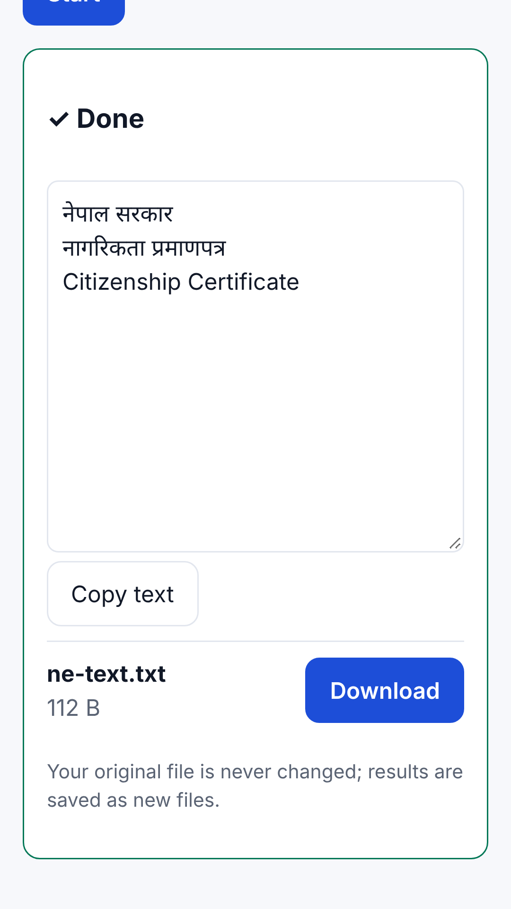
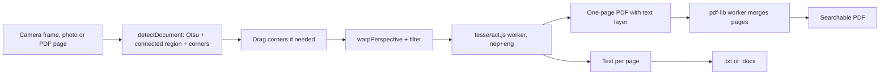

# Private PDF

Private PDF is a set of PDF and document-scanning tools that never upload the document. It detects and
flattens the page in a camera frame, runs OCR for Nepali and English with tesseract.js in a Web Worker, and
builds searchable PDFs, text or Word files entirely on the device. One TypeScript codebase ships as a web app and,
through Capacitor, as an Android app.

[](https://github.com/Sabin78910/private-pdf/actions/workflows/ci.yml)



## Features

- **On-device OCR, Nepali + English.** tesseract.js (LSTM engine) runs in a Web Worker with the `nep` and `eng`
  models served from the app itself, so OCR works offline. Output is plain text or a searchable PDF with an
  invisible text layer. PDF pages are rendered at 220 dpi, one page at a time, to keep memory low on phones.
- **Document scanner maths in plain TypeScript** (`src/core/scan.ts`): Otsu thresholding, largest connected
  bright region for page detection, a 3x3 homography solved by Gaussian elimination, bilinear perspective
  warp, and cleanup filters including an adaptive black-and-white threshold built on an integral image.
- **Live camera scanner.** Video frames are downscaled to 240 px and run through page detection; an outline only
  counts as a page within an area band and when it does not hug the frame, and it is smoothed between frames to
  stop jitter. Modes for OCR, ID cards, signatures, question papers and Word export, with batch capture.
- **PDF to Word.** pdf.js text positions are grouped into lines and paragraphs and written as a minimal `.docx`.
- **PDF editing in a worker** with pdf-lib: merge, split, compress, organise, fill and sign, page numbers,
  watermark, crop, redact and annotate. Cancel terminates the worker and drops all intermediate data.
- **Password protection** with AES-256 (PDF 2.0 standard security handler, V5/R6), implemented from
  ISO 32000-2 on top of WebCrypto.
- **Private by construction.** A Content-Security-Policy limits network access to the app's own origin (plus
  Google's sign-in script, only if the optional sign-in is enabled), and the browser smoke test fails if any
  request leaves the app. English and Nepali UI; a service worker caches the app for offline use.

## How it works



1. PDFs are rendered with pdf.js; photos and camera frames are read as RGBA pixel buffers.
2. `src/core/scan.ts` finds the page corners, corrects perspective and applies the chosen filter. All of it is
   pure functions on pixel arrays, so it is unit tested without a browser.
3. `src/platform/ocr.ts` keeps one cached tesseract worker per language setting and recognises each page,
   returning text and, when asked, a single-page PDF.
4. Page PDFs are merged in the pdf-lib Web Worker (`src/platform/jobs.worker.ts`) into the final searchable file.
5. Results are saved, shared (Capacitor Filesystem and Share on Android) or kept in an IndexedDB library.

## Tech stack

TypeScript, Vite, no UI framework · tesseract.js 5 · pdf.js (`pdfjs-dist`) · pdf-lib · fflate · jsQR ·
Capacitor 7 (Android) · Vitest · Playwright (smoke test) · GitHub Actions

## Getting started

Prerequisites: Node.js 22 (the version CI uses). For Android builds, JDK 21 and the Android SDK.

```bash
npm ci                 # postinstall copies the OCR engine and nep/eng models into public/ocr
npm run dev            # dev server
npm test               # unit tests (Vitest)
npm run typecheck      # tsc --noEmit
npm run build          # typecheck + production build in dist/
npm run budget         # fails if first-paint JS + CSS exceeds 60 KB gzipped
npm run android:sync   # build and copy the web app into the Android project
```

Browser smoke test (needs Playwright and Chromium installed):

```bash
npm run build && node e2e/smoke.mjs
```

Optional Google sign-in stays hidden unless a web OAuth client ID is supplied at build time
(`VITE_GOOGLE_CLIENT_ID=... npm run build`, or the `GOOGLE_CLIENT_ID` repository variable in CI). No tool needs it.

## Project structure

```
src/core/       pure logic with no DOM: scanner maths, camera rules, PDF operations, encryption, docx export
src/platform/   browser and Android glue: pdf.js rendering, OCR worker, job worker, file save/share, library store
src/tools/      one screen per tool
src/ui/         shared UI helpers, icons and views
src/i18n.ts     English and Nepali strings
tests/          Vitest unit tests
e2e/            Playwright smoke test against the production build
scripts/        OCR asset copy, startup budget check, CSS inlining
android/        Capacitor Android project
store/, fastlane/  Play listing text, screenshots and data safety answers
docs/           feature sheets, design tokens, Play release notes
```

## Testing and CI

- **Unit tests** (`tests/`) cover the core modules: page detection, homography and filters, camera scanner rules,
  crop, redact, AES-256 protection, Word export, ID card layout, QR parsing, annotations, watermark, page numbers,
  the on-device library, usage counters (frecency and the privacy ledger), service worker precache list, theme and stylesheet checks.
- **Smoke test** (`e2e/smoke.mjs`) runs tools in Chromium against the production build and asserts that no request
  leaves the app's origin.
- **`ci.yml`** runs on pull requests and pushes to `main`: typecheck, unit tests, build, startup budget, the
  Playwright smoke test, then an Android job that builds a debug APK and an unsigned release build.
- **`release.yml`** builds the Play App Bundle on pushes to `main`, on `v*` tags or on demand. It is signed only
  when the keystore secrets exist, and uploaded to Play internal testing only when a service account is configured.

## Design decisions and limitations

- **Classical image processing, not a learned detector.** Otsu plus connected regions is cheap enough to run on
  every preview frame, but it assumes a page brighter than its background. When no page stands out it returns the
  full frame and the user drags the corners.
- **Bundled OCR models instead of a CDN.** OCR works offline and the CSP can block every other host. The language
  data is cached by the service worker the first time OCR runs, not on first visit.
- **No UI framework**, so the first-paint bundle stays small on low-end phones; CI enforces the budget.
- **Known limits:** Nepali text inside PDF form fields is not supported yet; Medium and High compression rasterise
  pages, so text is no longer selectable until OCR is run again; password-protected PDFs are refused rather than
  unlocked; very large files (50 MB+) have a manual test plan but no automated benchmark.

## Author

Sabin Khanal · [Portfolio](https://sabinkhanal13.com.np) · [LinkedIn](https://www.linkedin.com/in/sabin-khanal-950163326) · [GitHub](https://github.com/Sabin78910)
